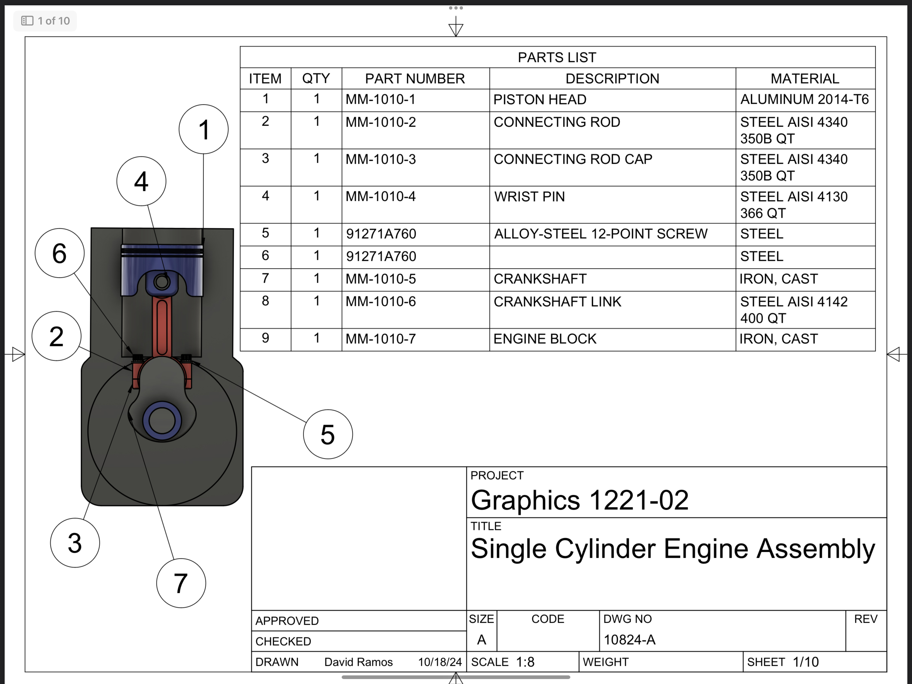
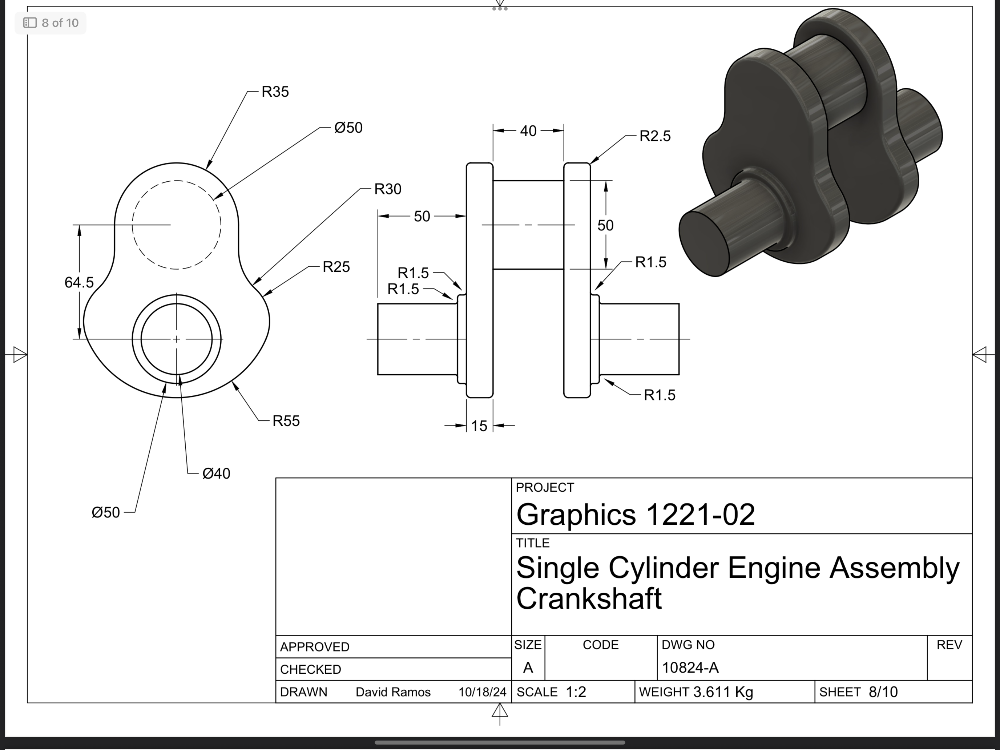
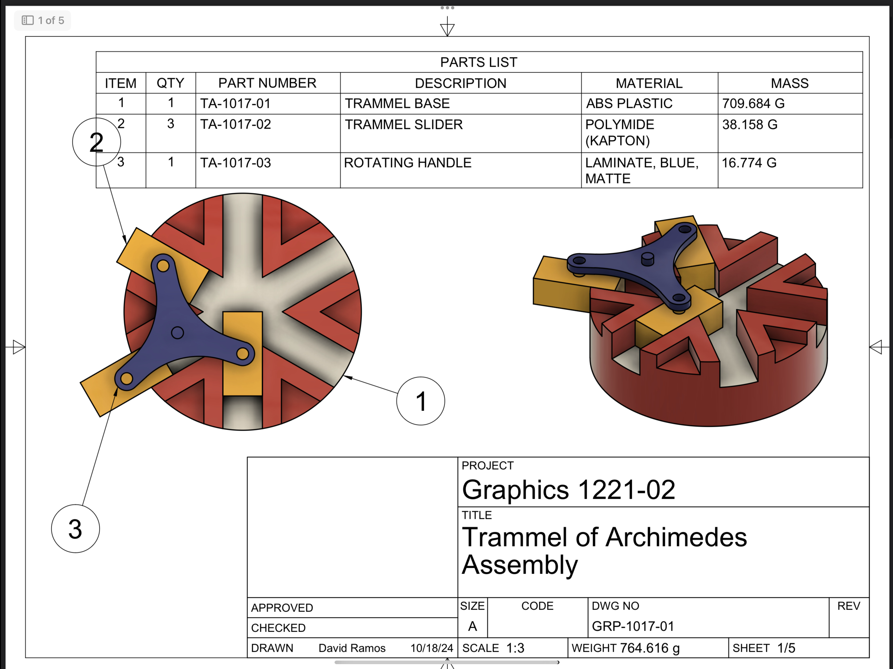
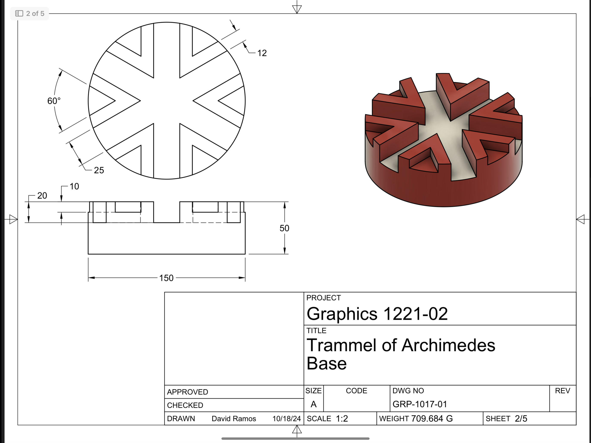

# David Ramos
**Mechanical Engineering Student | UTRGV**
Brownsville, TX · davideramos215@gmail.com · [LinkedIn](https://linkedin.com)

---

## About Me
I am a senior Mechanical Engineering student at UTRGV graduating in December 2026. My background is a mix of academic engineering design and practical field experience working with mechanical, structural, and fluid systems.

Before starting my engineering degree, I spent years working on ranch operations diagnosing and overhauling machinery. Because of that background, I look at CAD files and engineering problems through the lens of real-world manufacturing, easy maintenance, and reliability. I’m looking for an entry-level role in testing, manufacturing, or field engineering where I can get my hands dirty and solve practical problems.

---

## Core Skills

* **Software & Analysis:** SolidWorks, Autodesk Fusion 360, MATLAB, Python, LabVIEW
* **Fabrication & Shop Work:** Design for Manufacturability (DFM), structural framing, precision machining (drill press, saws, grinders), hand & power tools
* **Field Systems:** Root-cause failure analysis, small-engine overhauls, pneumatic components, fluid distribution lines

---

## Engineering Projects

### Autonomous Railroad Inspection Vehicle (Senior Design)
*Fabrication Team Lead | January 2026 - Present*

I lead the physical fabrication and mechanical systems integration for a 5-member team building a portable, modular railway inspection platform to identify track deformation and prevent derailments.
* Transitioned the platform from a standard chain assembly to a dual-motor brushless drivetrain using BLY343D motors for independent wheel rotation and electronic differential control around curves.
* Machined 1/4-inch 6061-T6 aluminum structural framing to tight geometric tolerances to ensure perfect axle alignment on a 55-inch wheelbase.
* Currently running trade studies comparing caliper disc brakes to drum brakes, and prototyping a rubber dampening isolation matrix to protect sensitive electronics from track vibrations.
* Managing the Bill of Materials (BOM) and parts sourcing, keeping our current build iteration under $400 out of a $750 total budget.

### Thermostat Sensor Analysis
*Team Lead — Measurements & Instrumentation | March 2026*

* Modeled first-order differential equations in MATLAB to evaluate how thermal sensor lag affects system response times.
* Applied statistical data analysis (standard deviation, 95% confidence intervals) to empirical measurements to validate sensor precision.
* Modeled how minor transient sensor delays cause continuous temperature swings, showing the direct financial impact of inaccurate readings on industrial utility costs.

---

## Practical Work History

### Mechanical Systems & Maintenance Specialist
*Independent Contractor & Ranch Operations | 2020 - 2025*
* Handled troubleshooting, tear-downs, and root-cause overhauls for more than 50 units of small-engine machinery, including cultivators, tillers, chainsaws, and pumps.
* Executed preventative and corrective overhauls on operational ranch vehicles, including dampening systems replacement, fluid optimization, and low-voltage electrical updates.
* Completed structural renovations and load-bearing framing adaptations for agricultural outbuildings.

## Additional Mechanical Design Projects

### Project 1: Single Cylinder Engine Assembly & Component Design
*Engineering Graphics Project | SolidWorks & GD&T Validation*

   
  

* **System Design:** Modeled a complete single-cylinder internal combustion engine assembly, specifying high-strength alloys and cast irons (Aluminum 2014-T6, Steel AISI 4340, Cast Iron) to withstand thermal and mechanical stresses.
* **Geometric Tolerancing & GD&T:** Developed full 2D engineering drawings for complex geometries including the crankshaft and engine block, ensuring precise feature control frames, concentricity, and mating clearances.
* **Mass & Structural Properties:** Calculated dynamic component weights (e.g., 880g Piston Head, 3.61kg Crankshaft) to analyze structural balance and ensure operational alignment.

### Project 2: Trammel of Archimedes Kinetic Mechanism
*Kinematic Modeling & Mechanical Tolerancing*

   
  

* **Mechanism Design:** Engineered a multi-axis Trammel of Archimedes linkage assembly utilizing sliding channels to convert rotary motion into linear geometric pathing.
* **Material & Manufacturing Strategy:** Specified exact material constraints across sliding interfaces, contrasting high-mass ABS plastic bases (709g) with lightweight low-friction Polyimide slider mechanisms.
* **Angular Precision:** Mapped precise 60-degree radial symmetry channels with exact tolerancing to prevent kinematic binding during high-speed rotation.
